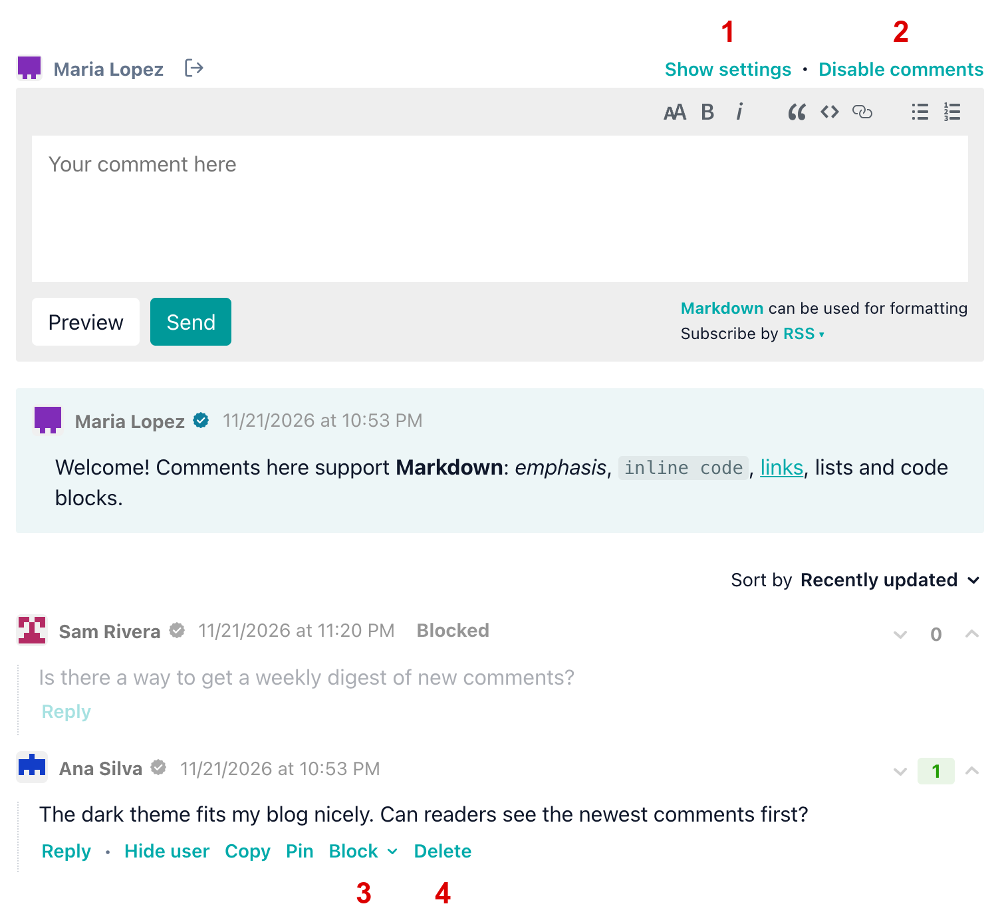
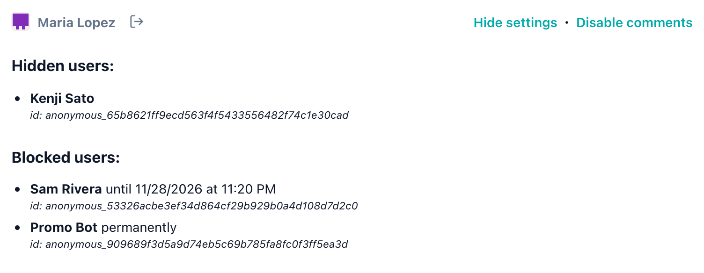
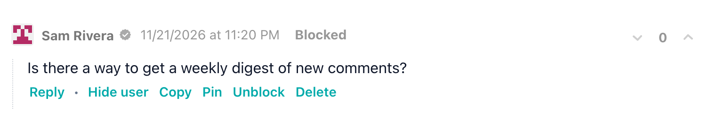
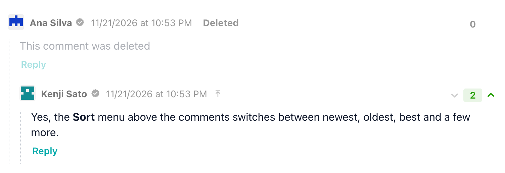

Administrators are defined by `admin.shared.id` / `$ADMIN_SHARED_ID` and get the following extra control elements. On a device with a mouse, the controls below a comment appear when the pointer is over that row.

1. **Show settings: lists of hidden and blocked users.** A blocked user can be unblocked from the list. Hidden users are every reader's own: any reader can hide a user with **Hide user** under a comment, and the list is kept in that reader's browser.
   

2. **Disable comments for the post.** Nobody can comment or vote on a disabled post, administrators included. **Enable comments** turns them back on, unless `READONLY_AGE` is set and the post's first comment is older than that many days.

3. **Block a user permanently, for a month, a week or a day.** A blocked user cannot post, edit or vote, and their comments are marked **Blocked**. A permanent block also deletes all of the user's comments. **Unblock** under the user's comment, or in the settings, lifts the block; it does not bring back comments deleted by a permanent block.
   

4. **Delete a comment.** A deleted comment that has replies stays in the thread as "This comment was deleted", so the replies keep their place; one without replies disappears.
   

5. **Pin a comment.** A pinned comment is also shown above all the others; **Unpin** removes it from there.

6. **Copy a comment.** Copies the author's name, the time and the text of the comment.

7. **Verify a user.** Administrators see a grey mark next to the name of every user who is not verified; clicking it verifies the user, and clicking the blue mark of a verified user removes the verification.

Blocking, unblocking, deleting, pinning, unpinning and verifying ask for confirmation first.
